# DisruptionIQ Architecture Diagrams Catalog

All flowcharts and sequence diagrams from the DisruptionIQ specifications have been rendered into scalable, high-resolution vector **SVG** (accessible with text elements) and raster **PNG** formats.

| Diagram Title | SVG Vector | PNG Image | Source Artifact |
| :--- | :--- | :--- | :--- |
| **End-to-End System Data Flow Architecture** | [View SVG](./diagrams/data_flow_end_to_end.svg) | [View PNG](./diagrams/data_flow_end_to_end.png) | `disruptioniq_data_flows_and_architectures.md` |
| **Inbound Signal Reconciliation & Ingestion Pipeline** | [View SVG](./diagrams/inbound_signal_ingestion_pipeline.svg) | [View PNG](./diagrams/inbound_signal_ingestion_pipeline.png) | `disruptioniq_data_flows_and_architectures.md` |
| **Impact Assessment & Risk Scoring Logic Flow** | [View SVG](./diagrams/impact_assessment_scoring_flow.svg) | [View PNG](./diagrams/impact_assessment_scoring_flow.png) | `disruptioniq_data_flows_and_architectures.md` |
| **Recovery Strategy Feasibility & Two-Person Authorization Pipeline** | [View SVG](./diagrams/recovery_strategy_authorization_pipeline.svg) | [View PNG](./diagrams/recovery_strategy_authorization_pipeline.png) | `disruptioniq_data_flows_and_architectures.md` |
| **Event Intake Status Lifecycle** | [View SVG](./diagrams/state_lifecycle_event_intake.svg) | [View PNG](./diagrams/state_lifecycle_event_intake.png) | `disruptioniq_data_flows_and_architectures.md` |
| **Inventory Lot Status Lifecycle** | [View SVG](./diagrams/state_lifecycle_inventory_lot.svg) | [View PNG](./diagrams/state_lifecycle_inventory_lot.png) | `disruptioniq_data_flows_and_architectures.md` |
| **Recovery Plan Status Lifecycle** | [View SVG](./diagrams/state_lifecycle_recovery_plan.svg) | [View PNG](./diagrams/state_lifecycle_recovery_plan.png) | `disruptioniq_data_flows_and_architectures.md` |
| **Freight Document Claim Status Lifecycle** | [View SVG](./diagrams/state_lifecycle_document_claim.svg) | [View PNG](./diagrams/state_lifecycle_document_claim.png) | `disruptioniq_data_flows_and_architectures.md` |
| **Sequence: Event Intake & Disruption Detection** | [View SVG](./diagrams/seq_event_intake_disruption_detection.svg) | [View PNG](./diagrams/seq_event_intake_disruption_detection.png) | `disruptioniq_implementation_report.md` |
| **Sequence: Recovery Plan Generation & Authorization** | [View SVG](./diagrams/seq_recovery_plan_authorization.svg) | [View PNG](./diagrams/seq_recovery_plan_authorization.png) | `disruptioniq_implementation_report.md` |
| **Sequence: Document Extraction & Review** | [View SVG](./diagrams/seq_document_extraction_review.svg) | [View PNG](./diagrams/seq_document_extraction_review.png) | `disruptioniq_implementation_report.md` |

---

## Direct Diagram Previews

### End-to-End System Data Flow Architecture
- **Formats**: [Vector SVG (Accessible, Scalable)](./diagrams/data_flow_end_to_end.svg) · [Raster PNG](./diagrams/data_flow_end_to_end.png)
- **Source**: `disruptioniq_data_flows_and_architectures.md`


---

### Inbound Signal Reconciliation & Ingestion Pipeline
- **Formats**: [Vector SVG (Accessible, Scalable)](./diagrams/inbound_signal_ingestion_pipeline.svg) · [Raster PNG](./diagrams/inbound_signal_ingestion_pipeline.png)
- **Source**: `disruptioniq_data_flows_and_architectures.md`


---

### Impact Assessment & Risk Scoring Logic Flow
- **Formats**: [Vector SVG (Accessible, Scalable)](./diagrams/impact_assessment_scoring_flow.svg) · [Raster PNG](./diagrams/impact_assessment_scoring_flow.png)
- **Source**: `disruptioniq_data_flows_and_architectures.md`


---

### Recovery Strategy Feasibility & Two-Person Authorization Pipeline
- **Formats**: [Vector SVG (Accessible, Scalable)](./diagrams/recovery_strategy_authorization_pipeline.svg) · [Raster PNG](./diagrams/recovery_strategy_authorization_pipeline.png)
- **Source**: `disruptioniq_data_flows_and_architectures.md`


---

### Event Intake Status Lifecycle
- **Formats**: [Vector SVG (Accessible, Scalable)](./diagrams/state_lifecycle_event_intake.svg) · [Raster PNG](./diagrams/state_lifecycle_event_intake.png)
- **Source**: `disruptioniq_data_flows_and_architectures.md`


---

### Inventory Lot Status Lifecycle
- **Formats**: [Vector SVG (Accessible, Scalable)](./diagrams/state_lifecycle_inventory_lot.svg) · [Raster PNG](./diagrams/state_lifecycle_inventory_lot.png)
- **Source**: `disruptioniq_data_flows_and_architectures.md`


---

### Recovery Plan Status Lifecycle
- **Formats**: [Vector SVG (Accessible, Scalable)](./diagrams/state_lifecycle_recovery_plan.svg) · [Raster PNG](./diagrams/state_lifecycle_recovery_plan.png)
- **Source**: `disruptioniq_data_flows_and_architectures.md`


---

### Freight Document Claim Status Lifecycle
- **Formats**: [Vector SVG (Accessible, Scalable)](./diagrams/state_lifecycle_document_claim.svg) · [Raster PNG](./diagrams/state_lifecycle_document_claim.png)
- **Source**: `disruptioniq_data_flows_and_architectures.md`


---

### Sequence: Event Intake & Disruption Detection
- **Formats**: [Vector SVG (Accessible, Scalable)](./diagrams/seq_event_intake_disruption_detection.svg) · [Raster PNG](./diagrams/seq_event_intake_disruption_detection.png)
- **Source**: `disruptioniq_implementation_report.md`

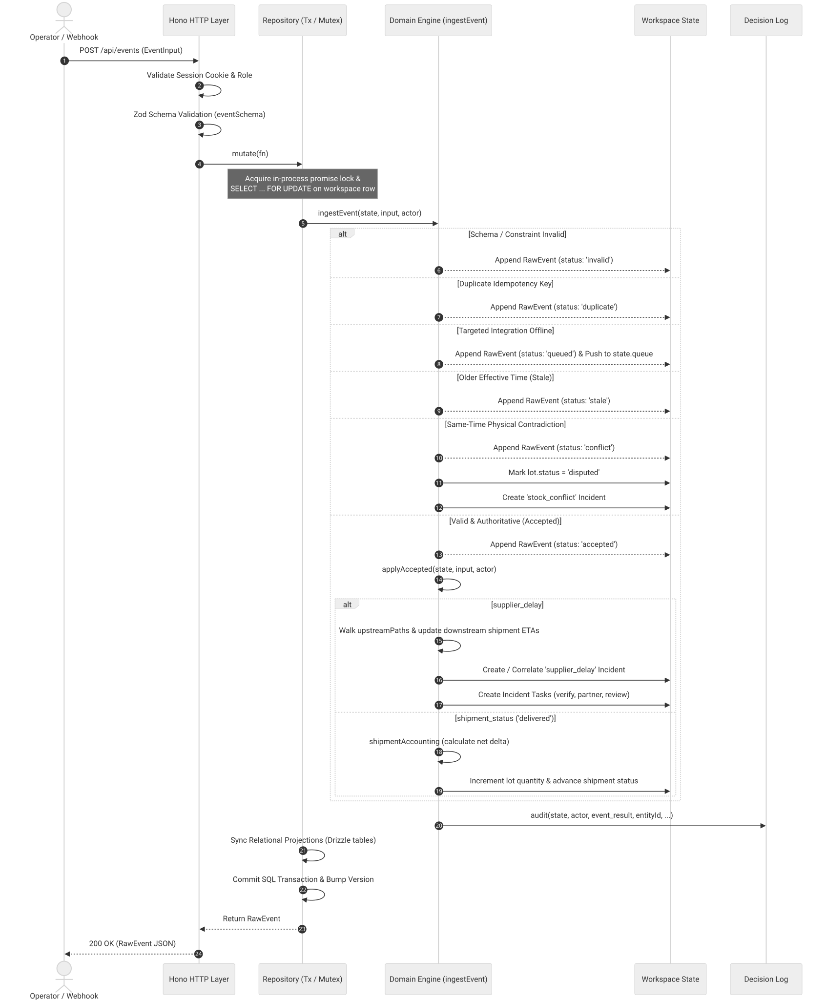

---

### Sequence: Recovery Plan Generation & Authorization
- **Formats**: [Vector SVG (Accessible, Scalable)](./diagrams/seq_recovery_plan_authorization.svg) · [Raster PNG](./diagrams/seq_recovery_plan_authorization.png)
- **Source**: `disruptioniq_implementation_report.md`

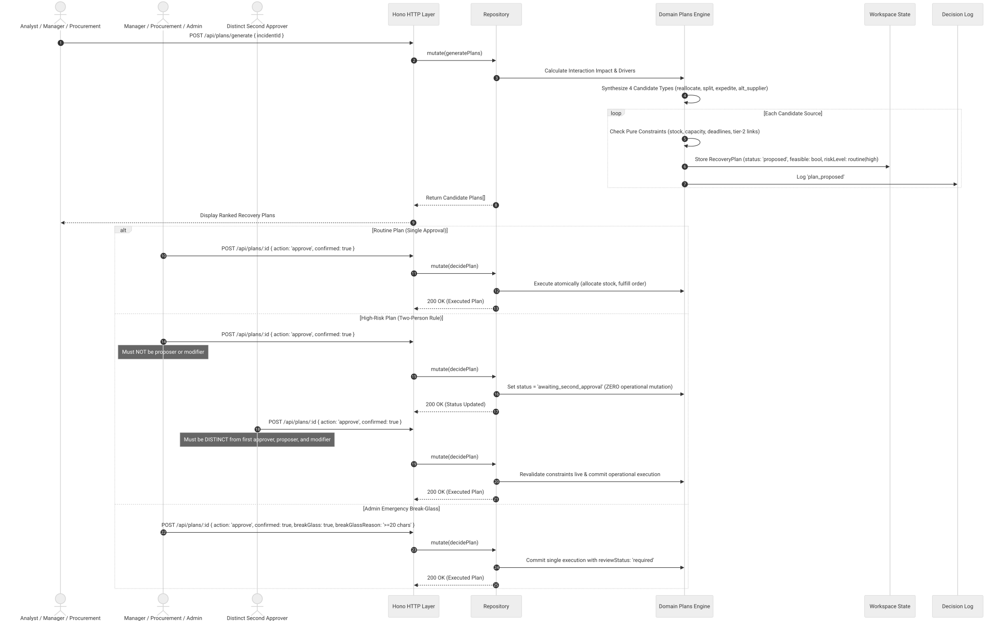

---

### Sequence: Document Extraction & Review
- **Formats**: [Vector SVG (Accessible, Scalable)](./diagrams/seq_document_extraction_review.svg) · [Raster PNG](./diagrams/seq_document_extraction_review.png)
- **Source**: `disruptioniq_implementation_report.md`

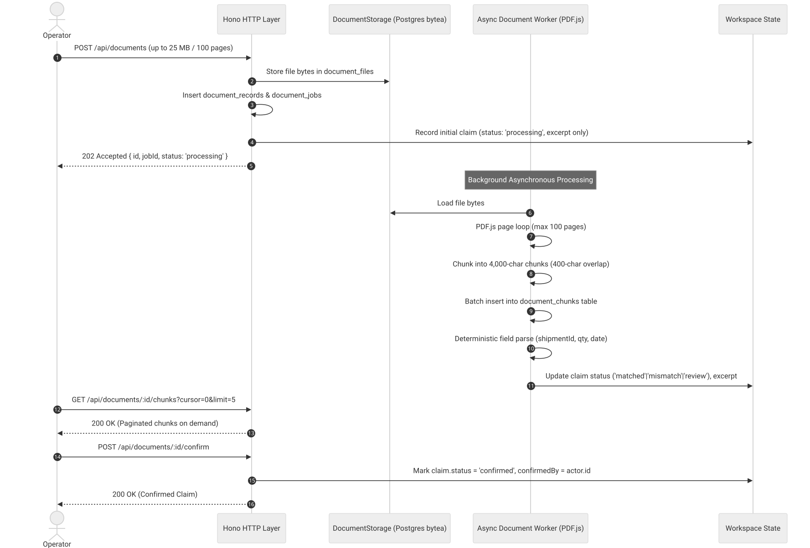

---

