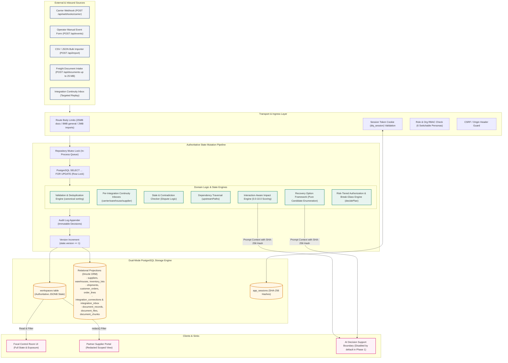
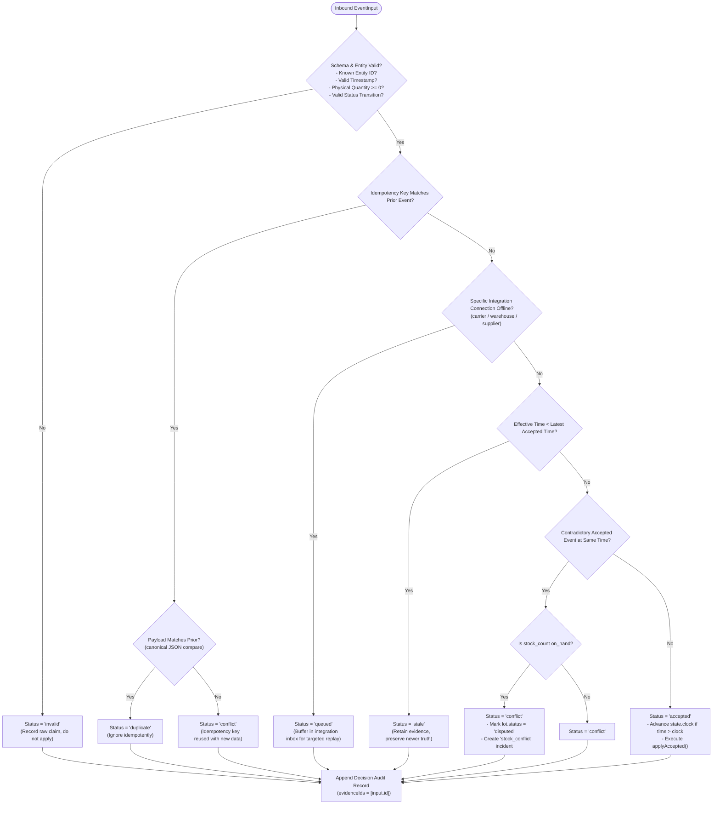
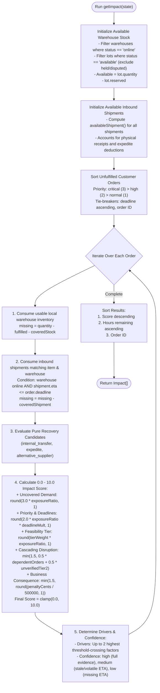
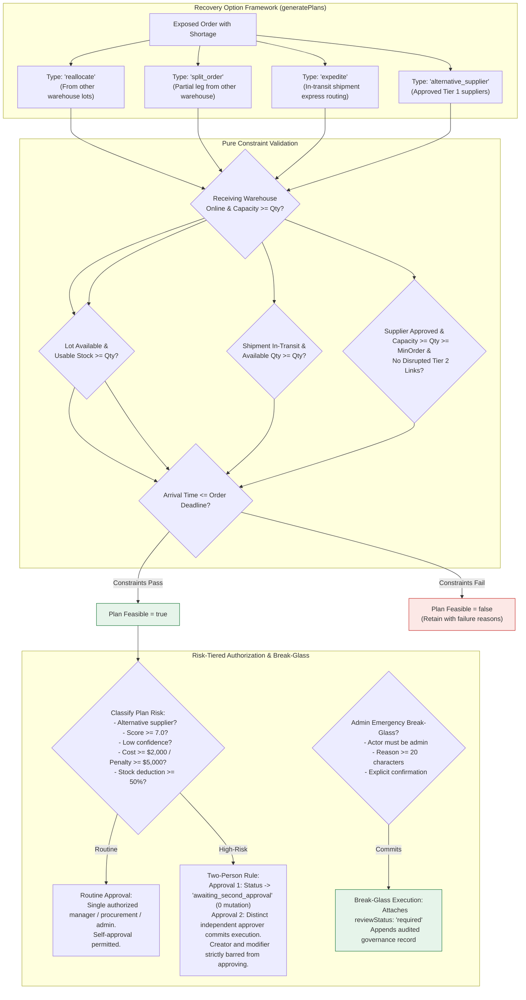
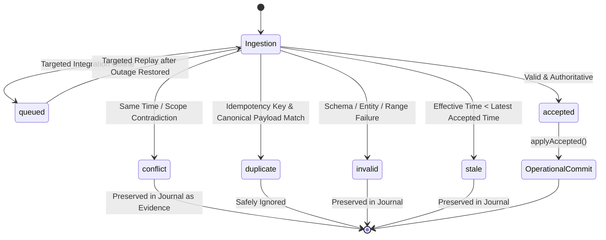
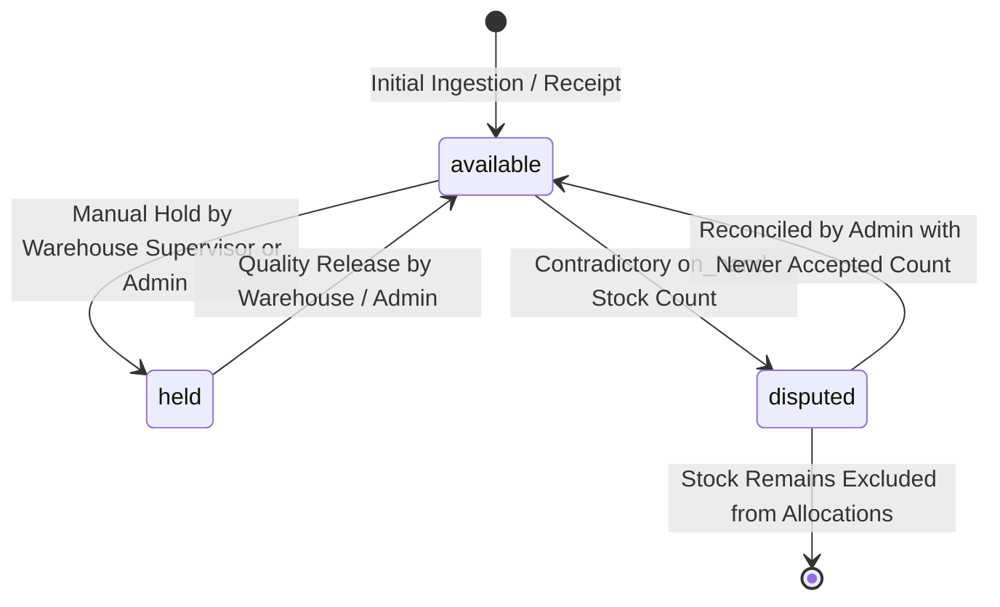
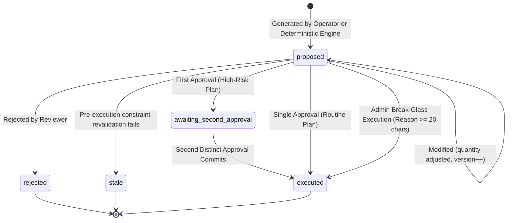
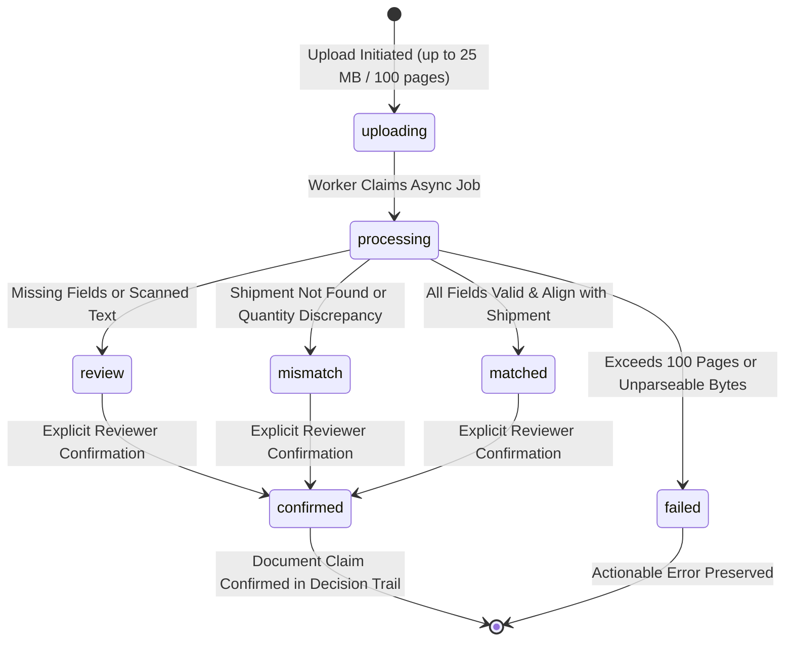

# DisruptionIQ: Data Flows, Execution Pipelines & Architecture Models

This document models the end-to-end data flows, lifecycle state machines, execution pipelines, and mathematical validation criteria of **DisruptionIQ**.

---

## 1. End-to-End System Data Flow Architecture

The following diagram illustrates how raw source data enters the platform from multiple origins, passes through validation, concurrency locks, and domain engines, and synchronizes to persistent PostgreSQL storage and client views.

---

## 2. Inbound Signal Reconciliation & Ingestion Pipeline

Every raw event passing through `ingestEvent()` undergoes an exact multi-stage decision tree before touching operational records.

---

## 3. Impact Assessment & Risk Scoring Logic Flow

The interaction-aware impact calculation engine (`getImpact()`) translates network disruptions, inventory holds, and warehouse outages into customer delivery exposures bounded between **0.0 and 10.0**.

---

## 4. Recovery Strategy Feasibility & Two-Person Authorization Pipeline

---

## 5. Lifecycle State Machine Diagrams

### 5.1 Event Intake Status Lifecycle

### 5.2 Inventory Lot Status Lifecycle

### 5.3 Recovery Plan Status Lifecycle

### 5.4 Freight Document Claim Status Lifecycle

---

## 6. Mathematical Evaluation & Correctness Criteria

To evaluate whether DisruptionIQ operations are executing correctly, verify the following mathematical bounds and logic constraints:

### 6.1 Inventory Accounting Conservation Invariant
For any inventory lot $L$:
$$0 \le L.\text{reserved} \le L.\text{quantity}$$
$$\text{usableStock}(L) = \begin{cases} L.\text{quantity} - L.\text{reserved} & \text{if } L.\text{status} = \text{'available'} \land \text{warehouse is online} \\ 0 & \text{otherwise} \end{cases}$$

### 6.2 Partial Delivery & Expedite Accounting Invariant
For any shipment $S$ with physical receipts $R_1, \dots, R_m$ and expedite plans $E_1, \dots, E_k$:
$$\text{physicalReceived} + \text{expedited} \le S.\text{quantity}$$
$$\text{availableShipment}(S) = \begin{cases} 0 & \text{if } S.\text{status} = \text{'delivered'} \\ \max(0, S.\text{quantity} - (\text{physicalReceived} + \text{expedited})) & \text{otherwise} \end{cases}$$
When an expedite plan of quantity $Q$ executes, it reserves $Q$ units of transit capacity. Subsequent cumulative delivery receipts of value $V$ add newly received stock $\Delta$ according to:
$$\Delta = \max\left(0, \max(V - \text{expedited}, 0) - \text{physicalReceived}\right)$$
This guarantees that units expedited express are never counted twice when the underlying container arrives.

### 6.3 Customer Order Exposure Invariant
For any open order $O$:
$$0 \le O.\text{fulfilled} \le O.\text{quantity}$$
$$\text{shortage}(O) \le O.\text{quantity} - O.\text{fulfilled}$$
An order's uncovered shortage cannot exceed its remaining unfulfilled units.

### 6.4 Risk Score Bounding & Drivers
For any impact assessment $I$:
$$0.0 \le I.\text{score} \le 10.0$$
Score calculation is strictly bounded between $0.0$ and $10.0$ with 1 decimal place. Exactly zero shortage yields $0.0$.
$$\text{bottleneckDrivers} \le 2$$
At most two primary bottleneck factors crossing operational thresholds are highlighted for immediate human triage.

### 6.5 Risk-Tiered Governance Invariant
For routine actions, authorized self-approval by manager, procurement, or admin is permitted. For high-risk actions ($S \ge 7.0$, alternative supplier, cost $\ge \$2,000$, penalty $\ge \$5,000$, consumption $\ge 50\%$, or low confidence):
$$\text{approvals}.\text{length} = 2 \land A_1.\text{id} \ne A_2.\text{id} \land A_i.\text{id} \ne P.\text{createdBy} \land A_i.\text{id} \ne P.\text{lastModifiedBy}$$
Break-glass execution permits an administrator to bypass the dual approval requirement only with an auditable justification of $\ge 20$ characters, setting `reviewStatus: 'required'`.
